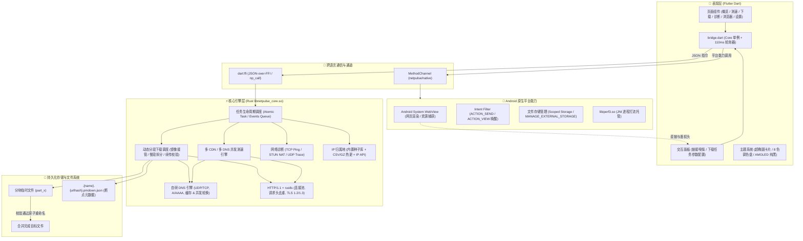

<p align="center">
  <a href="https://github.com/LianXia233/NetPulse">
    
  </a>
</p>

<h1 align="center">NetPulse</h1>

<p align="center">
  <strong>现代化 Android 网络测速、多线程断点下载与深度诊断套件</strong><br>
  Flutter 丝滑界面 · Rust 原生高性能核心 · 纯粹本地直连 · 零中转 · 零追踪
</p>

<p align="center">
  <a href="https://github.com/LianXia233/NetPulse/releases/latest"></a>
  <a href="https://github.com/LianXia233/NetPulse/actions/workflows/android.yml"></a>
  <a href="LICENSE"></a>
  
  
  
  
  <a href="https://github.com/LianXia233/NetPulse/releases"></a>
  <a href="https://github.com/LianXia233/NetPulse/stargazers"></a>
</p>

<p align="center">
  <a href="https://github.com/LianXia233/NetPulse/releases/latest">📦 立即下载 APK</a> •
  <a href="#-核心特性">✨ 核心特性</a> •
  <a href="#-系统架构">🏗️ 系统架构</a> •
  <a href="#-下载引擎核心机制与参数">⚙️ 下载参数</a> •
  <a href="#-编译与构建指南">🛠️ 编译构建</a> •
  <a href="docs/架构说明.md">📖 详细架构设计</a>
</p>

---

## 📖 项目简介

**NetPulse** 是一款专为 Android 打造的高性能多功能网络工具箱。它将**网络测速**、**多线程动态分块下载**、**网页直链资源嗅探**与**深度网络诊断**无缝融为一体。

- 🎨 **前沿美学设计**：前端采用 Flutter 构建，深度吸取 FlClash 界面语言，具备超椭圆微曲率卡片、贝塞尔动态平滑面积图、渐变速率仪表盘与八色主题系统。
- ⚡ **原生硬核性能**：底层网络 IO、多路 DNS 并发解析、TLS 加密通信、分块调度与诊断探针完全基于自研 **Rust 原生引擎**（`libnetpulse_core.so`）执行，享受无 GC、零中间层的高吞吐性能，并适配 Android 15+ 16 KB 内存页对齐标准。
- 🛡️ **纯粹安全隐私**：绝无自建中转服务，直连目标网络；零统计、零广告、免注册登录；敏感认证凭据物理隔离，捍卫用户网络隐私。

---

## ✨ 核心特性

| 模块 | 图标 | 能力解析 | 核心技术亮点 |
|:---|:---:|:---|:---|
| **网络测速** | ⚡ | **全链路真实带宽吞吐测试** | 支持多 CDN 轮询接入、多 DNS 极速并发解析、多线程并发压测；支持随机字节 Range 穿透中间缓存伪造；采样频率 100 ms–2 s 自适应调节，实时统计稳态与瞬时峰值。 |
| **下载调度** | ⬇️ | **高并发动态分块断点续传** | 支持 1–32 线程并发、64 KB–8 MB 动态分块切分；动态慢段对半拆分算法；多 CDN 镜像故障自动接管；断点续传 `.pmdown.json` 强校验；内置 HLS (AES-128 解密) 与 DASH 基础解析。 |
| **网页嗅探** | 🌐 | **内置浏览器与直链捕获** | 基于 Android System WebView，支持网页正常交互；自动嗅探页面直链与多媒体资源；支持一键将 Cookie、UA、Referer 与鉴权头注入下载引擎；深度集成 Android `SEND` / `VIEW` 分享唤醒。 |
| **网络诊断** | 🩺 | **多维网络体检工具集** | 内置 TCP Ping 纳秒级往返基准、DNS A/AAAA 多服务器解析横向对比、STUN NAT 穿透类型检测、UDP 路由追踪 (Traceroute) 以及内置 `libiperf3.so` 原生打流测试。 |
| **局域网透视** | 📡 | **网卡拓扑与链路全景** | 实时显示 IPv4 / IPv6 双栈地址、子网掩码、默认网关、MAC 物理地址、MTU、Wi-Fi/以太网协商链路速率、上游 DNS 节点及系统全量网络接口状态。 |
| **IP 归属地** | 🗺️ | **双模离线/在线出口探测** | 内置编译约 43 万条 IPv4 国家/地区段种子库（基于 DB-IP，零 IO 毫秒级二分匹配）；支持 CSV / CSV.GZ 离线包在线原子更新；支持多源出口探测及占位符 `{ip}` 自定义 API 扩展。 |
| **设计美学** | 🎨 | **现代化沉浸式交互与导航坞** | 经典超椭圆微曲率卡片与柔和层级；全新 **FlClash 风格悬浮胶囊导航坞（Floating Nav Dock）**，支持滑动透镜（Sliding Lens）、横向拖拽跟手与弹性物理动效；移动端精炼四标签流，设置收纳至顶栏；支持浅色、深色、AMOLED 纯黑底色，配备 8 种考究调色的 Accent 主题色。 |
| **隐私隔离** | 🛡️ | **零云端依赖与敏感凭据防护** | 无账号体系、无第三方追踪 SDK；所有网络流量端到端直连；敏感鉴权凭据（Cookie / Token）物理限制在应用私有存储，绝不污染公开下载目录，跨域自动剥离。 |

---

## 🏗️ 系统架构

NetPulse 采用 **Flutter UI + Rust 原生引擎 + Android Platform Channel** 的高内聚、松耦合分层设计：



### 通信协议与运行模型

1. **JSON-over-FFI 架构**：Flutter 通过 `dart:ffi` 绑定动态库 `libnetpulse_core.so` 的 `np_call` 接口。参数与响应统一采用 CString 封装的 JSON 格式传输。
2. **异步非阻塞任务模型**：耗时操作（如测速、下载、诊断）通过 `start_*` 命令异步拉起，立即返回全局递增生成的 `task_id`。底层执行线程被 `catch_unwind` 兜底保护，单点 Panic 不会导致 App 闪退。
3. **低延迟事件轮询**：前端定时器以 110 ms 间隔通过 `task_poll` 拉取事件增量，实现毫秒级平滑图表绘制与任务控制（`task_cancel`、`task_dispose`）。

更深入的技术规范请参阅 [`docs/架构说明.md`](docs/架构说明.md)。

---

## ⚙️ 下载引擎核心机制与参数

NetPulse 针对复杂多变的网络环境研发了稳健的动态分块调度引擎：

```
主下载源 ────► [HEAD/探测] ───► 获取总大小 / Range 标识
                        │
                        ▼
                [按连接数动态切块]
          Worker 1    Worker 2    Worker 3
             │           │           │
    ┌────────▼───────────▼───────────▼────────┐
    │          原子并发任务队列 (Atomic Queue)          │
    └────────┬───────────┬───────────┬────────┘
             ▼           ▼           ▼
        [主地址]     [镜像 CDN1]   [镜像 CDN2]  (遇错自动故障轮询接管)
             │           │           │
             └───────────┼───────────┘
                         ▼
             [慢速分段无空洞对半拆分]
                         │
                         ▼
             [随机写入 FileExt::write_at]
                         │
                         ▼
             [全区间覆盖校验 & fsync 原子重命名]
```

### `start_download` 参数参考

| 参数名 | 类型 | 说明与范围 | 默认行为 / 特性 |
|:---|:---:|:---|:---|
| `url` | `String` | 主下载链接 | 保留原样查询串与防盗链签名 |
| `mirrors` | `List<String>` | 同一文件的多 CDN 镜像地址 | 分段失败时轮询接管，实现多源容灾 |
| `headers` | `Map<String, String>` | 自定义请求头 | 支持 UA、Referer、Cookie、Authorization；同名去重；跨域重定向自动剔除敏感头 |
| `dns_servers`| `List<String>` | 任务专属 DNS 服务器列表 | 可单独覆盖全局 DNS 解析策略 |
| `connections`| `int` | 并发连接数（1 – 32） | 默认动态计算并发策略 |
| `block_kb` | `int` | 单分块大小（64 KB – 8 MB） | 固定分块大小切分，未指定则根据总大小自适应切分 |
| `retries` | `int` | 单分块失败重试次数（0 – 10） | 指数退避重试，超限自动迁移到镜像节点 |

### 断点续传与防损坏校验

- **元数据落盘**：每个下载任务在存储目录下生成同名隐藏元数据文件 `.{filename}.{urlhash}.pmdown.json`，持久化记录 URL 哈希、总大小、分块偏移、已完成字节数、镜像与 ETag。
- **凭据物理隔离**：用户的 `Cookie` 与 `Authorization` 等敏感身份凭据只存储在 App 私有沙盒，**绝不写入公开存储的元数据文件**，避免凭据泄漏。
- **严格完整性闭环**：任务完成前必须通过分段连续性检验，断定区间 `[0, total_size)` 严丝合缝无任何空洞，经 `fsync` 刷盘后原子重命名为最终文件。

---

## 📦 安装包与发布验证

正式版 APK 发布于 [GitHub Releases](https://github.com/LianXia233/NetPulse/releases/latest)。

每次 CI 流水线从 `app/pubspec.yaml` 提取版本号（如 `v1.1.0`），自动构建正式 Release，并附带对应 APK 及其 SHA-256 校验文件。

### 官方发布证书指纹

为防止供应链劫持或非官方篡改，建议在安装前校验 APK 证书指纹：

```text
SHA-256 指纹: 118ea38fc17a465dce8fe2c7657d0b4d3c7273e6379f3a0a9b73f5f80a106d6b
SHA-1   指纹: 5b9dae93c7ec8bb6e2fc996196666548120782cc
```

校验命令示例（需安装 Android SDK Build-Tools）：
```bash
apksigner verify --print-certs NetPulse-1.1.0.apk
```

---

## 🛠️ 编译与构建指南

### 构建环境依赖

| 组件 | 版本要求 | 用途 |
|:---|:---|:---|
| **Flutter SDK** | `3.50.1` (Dart `^3.14.0`) | 前端 UI 框架 |
| **JDK** | `17` (LTS) | Android 构建环境 |
| **Android SDK** | `compileSdk 36`, `minSdk 24`, `targetSdk 36` | Android 目标平台配置 |
| **Android NDK** | `28.2.13676358` | Rust C/C++ 交叉工具链 |
| **Rust** | `stable` (Edition 2021) | 核心引擎底层 |
| **Rust 交叉目标** | `aarch64-linux-android`, `armv7-linux-androideabi` | Android 目标架构库 |

### 本地构建步骤

> 推荐在 Linux、macOS 或 Windows WSL 环境下执行：

```bash
# 1. 克隆代码仓库
git clone https://github.com/LianXia233/NetPulse.git
cd NetPulse

# 2. 安装 Rust 交叉编译目标架构
rustup target add aarch64-linux-android armv7-linux-androideabi

# 3. 指定 Android SDK 路径并运行一键打包脚本
export ANDROID_HOME=/path/to/android-sdk
bash tools/build.sh
```

一键脚本会自动执行：
1. 注入 `-Clink-arg=-Wl,-z,max-page-size=16384` 标志，编译符合 Android 15+ 16 KB 页对齐规范的 `libnetpulse_core.so`；
2. 自动分发 so 库至 `app/android/app/src/main/jniLibs/{arm64-v8a,armeabi-v7a}`；
3. 执行 `flutter build apk --release` 构建通用安装包；
4. 输出最终成果物至 `dist/NetPulse-<version>.apk`。

### GitHub Actions 持续集成 (CI)

本仓库配置有完整的持续集成自动化流水线 [`.github/workflows/android.yml`](.github/workflows/android.yml)：
- **代码门禁**：推送代码时自动执行 Flutter `analyze` / `test` 以及 Rust `test` / `clippy` 静态分析；
- **真实签名与验证**：从 GitHub Actions Secrets 解密官方发布 Keystore 进行签名，使用 `apksigner` 强制比对证书 SHA-256，验证失败自动阻断发布；
- **自动发版**：版本号更新时自动触发 GitHub Release 发布并关联分发资产。

---

## 📂 项目结构

```text
NetPulse/
├── app/                                # Flutter 客户端工程
│   ├── android/                        # Android 原生配置与 jniLibs 容器
│   │   └── app/build.gradle.kts        # Android Gradle Kotlin DSL 配置
│   ├── lib/                            # Dart 代码
│   │   ├── pages/                      # 页面实现 (仪表盘、测速、下载、诊断、浏览器等)
│   │   ├── floating_nav.dart           # FlClash 悬浮胶囊导航坞与跟手物理动效
│   │   ├── bridge.dart                 # Core 单例 (FFI / MethodChannel)
│   │   ├── download_sheet.dart         # 任务下载面板与参数提取
│   │   ├── theme.dart                  # FlClash 风格超椭圆与配色规范
│   │   └── main.dart                   # 应用生命周期入口
│   └── pubspec.yaml                    # Flutter 依赖与版本声明
├── core/                               # Rust 核心引擎
│   ├── src/
│   │   ├── lib.rs                      # FFI 导出 (np_call / 任务轮询调度)
│   │   ├── speed.rs                    # 多 CDN / 多 DNS 并发测速引擎
│   │   ├── download.rs                 # 动态分段下载调度与断点续传
│   │   ├── dns.rs                      # 自研高性能 DNS 解析与缓存
│   │   ├── http.rs                     # HTTP/1.1 客户端与 rustls TLS 栈
│   │   ├── diag.rs                     # Ping / STUN / Traceroute / iperf3
│   │   └── ipgeo.rs                    # 离线 IP 库二分查找与在线出口探针
│   ├── assets/ipdb_seed.tsv.gz         # 内置离线 IP 库种子数据 (~43 万条)
│   └── Cargo.toml                      # Rust 核心包依赖声明
├── docs/                               # 项目技术文档与静态资源
│   ├── 架构说明.md                      # 深度架构设计与通信协议规范
│   └── assets/icon.png                 # 应用官方高清图标
├── tools/
│   └── build.sh                        # 交叉编译与自动化打包脚本
└── .github/workflows/android.yml       # GitHub Actions 自动化 CI/CD
```

---

## ⚠️ 已知限制与说明

- **系统要求**：最低支持 Android 7.0 (API 24) 及以上，原生包覆盖 `arm64-v8a` 与 `armeabi-v7a`。暂不分发 x86/x86_64 模拟器架构。
- **存储访问降级**：Android 11+（API 30+）使用 `MANAGE_EXTERNAL_STORAGE` 权限向公共 Download 目录落盘；在 Android 7–10 缺失存储权限时会自动降级存储至 App 专属沙盒目录 `Android/data/com.netpulse.app/files/Download/NetPulse`。
- **诊断兼容性**：内置 `libiperf3.so` 打流引擎要求 Android 9.0（API 28）及以上版本支持。
- **流媒体协议边界**：HLS 模块原生支持标准切片及 AES-128 自动解密；DASH 暂不支持多音轨自适应切换、DRM 保护及 `$Time$` 动态模板分段。
- **服务端 Range 限制**：若目标 HTTP 服务器完全不支持 `Range` 范围请求，下载器将退化为单连接下载，重试时重新下载，不支持字节级断点续传。
- **进程生命周期**：若应用进程被 Android 系统强行回收，后台任务不会自动常驻；断点元数据会完整保留，重新打开 App 后可一键无缝恢复。

---

## 🔒 数据与隐私安全

- **零数据上报**：绝不收集设备信息、剪贴板隐私、使用行为，代码中不含任何第三方广告或统计追踪 SDK。
- **点对点直接通信**：所有网络流量、测速包与下载切片均由客户端与目标服务器直连，无任何中转代理。
- **凭据生命周期严格受控**：嗅探捕获或用户填写的 Cookie / Authorization 头仅驻留在受系统沙盒保护的私有目录中，下载完成或用户删除任务时即刻清除，避免泄露风险。
- **数据来源归属**：内置离线 IP 数据库来源于 [DB-IP](https://db-ip.com)，遵循 [CC BY 4.0](https://creativecommons.org/licenses/by/4.0/) 许可分发。

---

## 📄 开源许可证

本项目源码基于 [MIT License](LICENSE) 开源。

随包包含的第三方开源组件（Flutter、Rust、rustls、iperf3、DB-IP 等）均遵循各自上游许可证分发，详情请参阅 [`THIRD_PARTY_NOTICES.md`](THIRD_PARTY_NOTICES.md)。

---

## 💡 致谢

- 界面交互及设计哲学灵感来自 [FlClash](https://github.com/chen08209/FlClash)；
- 动态分块切分、慢段对半拆分与分段校验思路参考了 [FluxDown](https://github.com/zerx-lab/FluxDown)；
- 感谢 [Flutter](https://flutter.dev)、[Rust](https://www.rust-lang.org)、[rustls](https://github.com/rustls/rustls)、[iperf3](https://github.com/esnet/iperf) 及 [DB-IP](https://db-ip.com) 等优秀开源项目。
