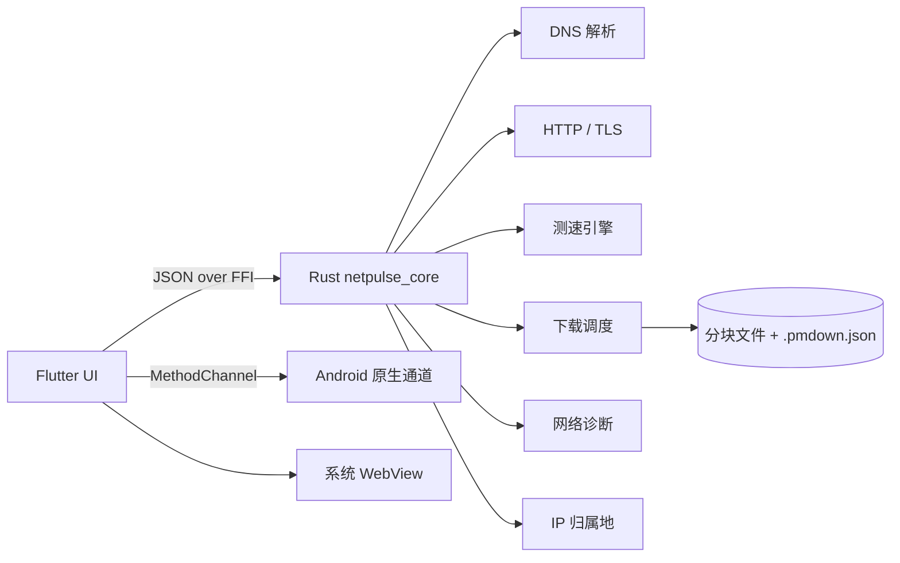

<p align="center">
  
</p>

<h1 align="center">NetPulse</h1>

<p align="center">
  <strong>Android 网络测速、下载与诊断工具</strong><br>
  Flutter 界面 · Rust 核心 · 本地直连 · 无需账号
</p>

<p align="center">
  <a href="https://github.com/LianXia233/NetPulse/actions/workflows/android.yml"></a>
  <a href="LICENSE"></a>
  <a href="https://github.com/LianXia233/NetPulse/releases"></a>
  
  
  
</p>

> NetPulse 把测速、下载、网页直链捕获和网络诊断放在一个 Android 客户端里。界面用 Flutter，测速、下载、DNS 与诊断等核心逻辑在本机 Rust 引擎执行，不经过自建中转服务。

## 功能

| 模块 | 能力 |
|---|---|
| ⚡ 测速 | 下载 / 上传测速；多 CDN 轮询、多 DNS 并发解析、多线程连接；随机 Range 绕过缓存；250 ms 采样，输出稳态与峰值。 |
| ⬇️ 下载 | 动态分块队列、1–32 并发连接、64 KB–8 MB 分块；多 CDN 镜像接管、请求头完整透传、断点续传、失败重试；HLS / DASH 基础支持。 |
| 🌐 浏览器 | 系统 WebView 打开网页，嗅探页面直链；把 Cookie、UA、Referer 与鉴权参数带入下载器；支持系统分享和外部链接唤起。 |
| 🩺 诊断 | TCP Ping、DNS A/AAAA 多服务器对照、STUN NAT 检测、UDP 路由追踪、内置 iperf3。 |
| 📡 局域网 | 展示 IPv4 / IPv6、子网掩码、网关、MAC、MTU、链路速率、DNS 与全部网卡。 |
| 🗺️ IP 归属地 | 内置约 43 万条 IPv4 国家/地区段；支持 CSV / CSV.GZ 更新；可配置 IP API，显示国家、地区、城市、ISP、ASN、坐标与时区。 |
| 🎨 界面 | FlClash 风格超椭圆卡片、渐变表盘、平滑面积图、药丸分段控件；浅色 / 深色 / 纯黑与八色主题。 |

## 下载

正式版 APK 发布在 [GitHub Releases](https://github.com/LianXia233/NetPulse/releases)。CI 会根据 `app/pubspec.yaml` 的版本号创建或更新对应 `vX.Y.Z` 的正式 Release（非 draft / prerelease），并附带 APK 与 SHA-256 校验文件。

## 下载参数

`start_download` 支持逐任务覆盖：

| 参数 | 说明 |
|---|---|
| `url` | 主下载地址，查询串与签名原样保留 |
| `mirrors` | 同一文件的多 CDN 镜像，分段轮询接管 |
| `headers` | UA、Referer、Cookie、Authorization 及任意自定义头 |
| `dns_servers` | 该任务使用的 DNS 列表 |
| `connections` | 并发连接数 1–32 |
| `block_kb` | 分块大小 64 KB–8 MB |
| `retries` | 单分块失败重试次数 0–10 |

这些参数会写入续传元数据，暂停后恢复时原样复用。默认保存目录为 `/storage/emulated/0/Download/NetPulse`，也可以在设置或单次下载时修改。

## 架构



Flutter 通过 `dart:ffi` 调用 `libnetpulse_core.so` 的 `np_call`，请求与响应都是 JSON；文件选择、目录准备、网络信息等平台能力走 Android `MethodChannel`。Rust 侧用 `task_id` + 轮询事件模型向前端推送进度。

更细的模块划分、下载调度和链接推送流程见 [`docs/架构说明.md`](docs/架构说明.md)。

## 构建

### 环境

| 依赖 | 版本 |
|---|---|
| Flutter / Dart | 3.50.1 / 3.14.0 |
| JDK | 17 |
| Android SDK | compileSdk 36，minSdk 24 |
| Build Tools | 36.0.0 |
| NDK | 27.3.13750724 |
| Rust | stable，`aarch64-linux-android` + `armv7-linux-androideabi` |

### 本地构建

```bash
rustup target add aarch64-linux-android armv7-linux-androideabi

export ANDROID_HOME=/path/to/android-sdk
bash tools/build.sh
```

脚本会先交叉编译 Rust 核心，再构建 arm64-v8a / armeabi-v7a 双架构 APK，输出到 `dist/NetPulse-1.0.9.apk`。若 `ANDROID_HOME` 未设置，脚本会尝试 `$HOME/toolchain/android/sdk`。

### CI 云编译

[`.github/workflows/android.yml`](.github/workflows/android.yml) 在推送到 `main` 或手动触发时执行：

- 安装 Flutter 3.50.1、JDK 17、Android SDK 36、NDK 27.3 与 Rust Android targets；
- 从 GitHub Actions Secrets 还原 release keystore，构建并签名 APK；
- 用 `apksigner` 校验发布证书 SHA-256，校验通过后才上传 `NetPulse-APK-*` Artifact；
- 从 `app/pubspec.yaml` 读取当前版本，自动创建或更新 `vX.Y.Z` 正式 Release，上传 APK 与 SHA-256 校验文件。

仓库不包含 keystore 和 `key.properties`。本地没有签名材料时，Gradle 会回退到 debug 签名；CI 缺少签名 Secret 时会直接失败，不会用 debug 包冒充发布包。

当前发布证书指纹：

```text
SHA-256  118ea38fc17a465dce8fe2c7657d0b4d3c7273e6379f3a0a9b73f5f80a106d6b
SHA-1    5b9dae93c7ec8bb6e2fc996196666548120782cc
```

## 项目结构

```text
.
├── app/                         Flutter UI
│   ├── lib/
│   │   ├── pages/               首页、测速、下载、工具、设置等页面
│   │   ├── bridge.dart          FFI 与 MethodChannel 桥
│   │   └── download_sheet.dart  链接推送与下载参数弹层
│   └── android/                 Android 工程
├── core/                        Rust 引擎
│   ├── src/                     dns / http / speed / download / diag / ipgeo
│   └── assets/ipdb_seed.tsv.gz  内置 IP 归属地种子库
├── docs/
│   ├── 架构说明.md
│   └── assets/icon.png
├── tools/build.sh               本地构建脚本
└── .github/workflows/android.yml
```

## 已知限制

- 仅发布 Android 7.0+ 的 arm64-v8a / armeabi-v7a 版本，不含 x86 模拟器包。
- HLS 目前支持 AES-128；DASH 暂不支持多音轨、DRM 与 `$Time$` 模板。
- 进程被系统杀死后不会自动后台续跑。任务记录会保留，可在下载页或详情页手动“继续”；HLS / DASH 继续时会重新解析清单。
- 不含 VPN 分流、悬浮窗、双卡绑定等系统级能力。
- 内置浏览器依赖 Android System WebView，网页行为受系统 WebView 版本和目标站点策略影响。

## 数据与隐私

- 不集成账号系统、统计 SDK 或广告 SDK。
- 测速、下载与诊断请求直接发往用户配置的 CDN、DNS 或目标服务器，不经过自建中转。
- 下载地址、请求头、Cookie 等参数只保存在本机和下载目录的 `.pmdown.json` 元数据中。
- IP 归属地数据来自 [DB-IP](https://db-ip.com)，按 CC BY 4.0 使用，可在应用内更新。

## 开源许可

NetPulse 源码以 [MIT License](LICENSE) 发布。

随包分发的 iperf3、Flutter 运行时、Rust 依赖、DB-IP 数据等第三方组件适用各自许可，完整说明见 [`THIRD_PARTY_NOTICES.md`](THIRD_PARTY_NOTICES.md)。

## 致谢

界面组织参考了 [FlClash](https://github.com/chen08209/FlClash)，下载交互参考了 [FluxDown](https://github.com/zerx-lab/FluxDown)；同时感谢 Flutter、Rust、rustls、iperf3 与 DB-IP 等开源项目。
