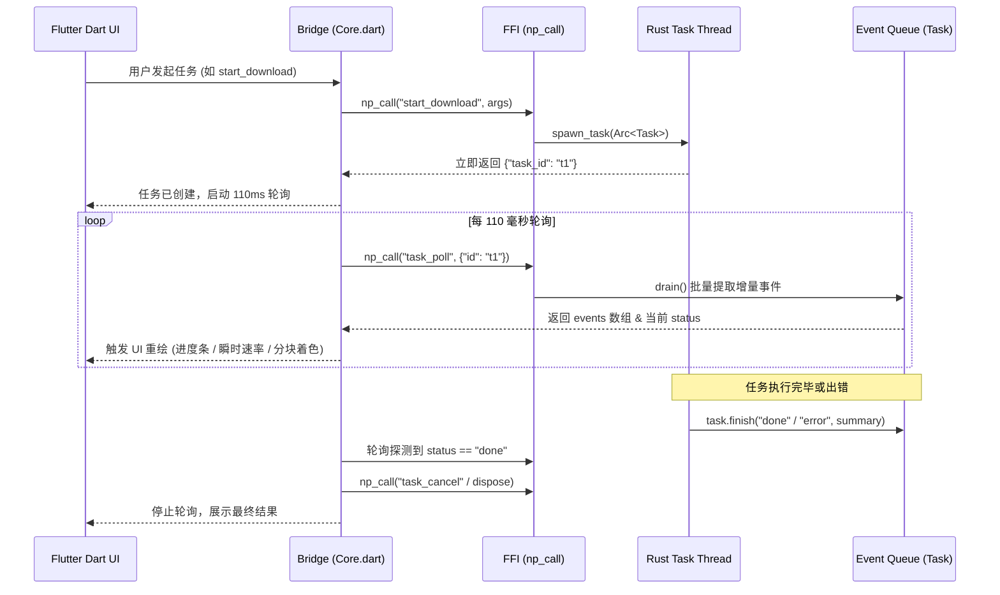
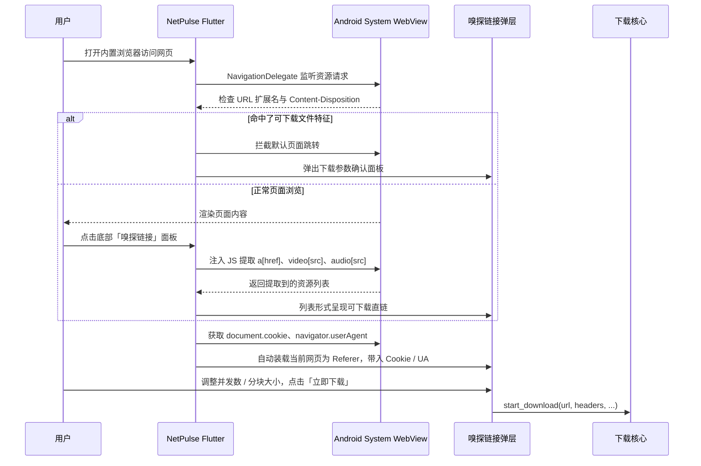

# NetPulse 架构与技术实现说明

NetPulse 是一个结合了 **Flutter 前端表现层**、**Rust 原生高性能核心引擎** 与 **Android 原生平台能力** 的现代化网络工具套件。本文档详细阐述其系统架构、核心子系统设计、通信协议、下载调度算法与安全隐私模型。

---

## 目录

- [1. 系统架构分层](#1-系统架构分层)
- [2. FFI 通信与异步任务模型](#2-ffi-通信与异步任务模型)
- [3. 下载调度与断点续传引擎](#3-下载调度与断点续传引擎)
- [4. 网络与 TLS 通信层](#4-网络与-tls-通信层)
- [5. 网页直链嗅探与系统集成](#5-网页直链嗅探与系统集成)
- [6. IP 归属地与网络诊断子系统](#6-ip-归属地与网络诊断子系统)
- [7. 构建系统与 Android 15 适配](#7-构建系统与-android-15-适配)
- [8. 安全与隐私防护规范](#8-安全与隐私防护规范)

---

## 1. 系统架构分层

NetPulse 采用职责严格分离的自顶向下三层架构：

```mermaid
graph TD
    subgraph UI [Flutter 表现层 (Dart)]
        UI_Dash[仪表盘与网络状态]
        UI_Speed[测速页面 & 动态折线图]
        UI_Down[下载管理器 & 详情监控]
        UI_Browser[内置嗅探浏览器]
        UI_Diag[网络诊断工具箱]
        UI_Geo[IP 归属地与查询]
        UI_Theme[超椭圆卡片与八色主题规范]
        UI_Dock[FlClash 悬浮胶囊导航坞 & 拖拽跟手]
        UI_Bridge[Core 单例 Bridge / 轮询调度器]
    end

    subgraph Channel [跨语言桥接通道]
        FFI_Layer[dart:ffi / JSON-over-FFI]
        Platform_Channel[MethodChannel: netpulse/native]
    end

    subgraph Native [Android 平台层 (Kotlin / JNI)]
        Native_Intent[Intent 接收 (ACTION_SEND / ACTION_VIEW)]
        Native_WebView[Android System WebView 渲染宿主]
        Native_Storage[存储目录适配 / 权限降级策略]
        Native_Iperf[libiperf3.so 打流守护进程]
    end

    subgraph Core [Rust 核心引擎 (libnetpulse_core.so)]
        Task_Pool[全局任务池 & 轮询事件队列]
        DNS_Engine[自研 DNS 解析引擎 (UDP/TCP, A/AAAA)]
        HTTP_Engine[自研 HTTP/1.1 客户端 + rustls 栈]
        Speed_Engine[多 CDN / 多 DNS 并发测速引擎]
        Download_Engine[动态分段下载 / 镜像容灾 / 完整性校验]
        Diag_Engine[TCP Ping / STUN / UDP Trace]
        Geo_Engine[离线 IP 库 (二分匹配) + 在线出口探测]
    end

    UI_Dash --> UI_Bridge
    UI_Speed --> UI_Bridge
    UI_Down --> UI_Bridge
    UI_Browser --> UI_Bridge
    UI_Diag --> UI_Bridge
    UI_Geo --> UI_Bridge

    UI_Bridge -->|C-String JSON 命令| FFI_Layer
    UI_Bridge -->|平台原生请求| Platform_Channel

    Platform_Channel --> Native_Intent
    Platform_Channel --> Native_WebView
    Platform_Channel --> Native_Storage
    Platform_Channel --> Native_Iperf

    FFI_Layer --> Task_Pool
    Task_Pool --> Speed_Engine
    Task_Pool --> Download_Engine
    Task_Pool --> Diag_Engine
    Task_Pool --> Geo_Engine

    Download_Engine --> DNS_Engine
    Download_Engine --> HTTP_Engine
    Speed_Engine --> DNS_Engine
    Speed_Engine --> HTTP_Engine
```

---

## 2. FFI 通信与异步任务模型

### 2.1 内存交互与 JSON-over-FFI

Flutter 与 Rust 之间摒弃了笨重的高开销代码生成框架，采用轻量稳定的 **JSON-over-FFI** 协议：

- **导出接口**：
  - `np_call(ptr: *const c_char) -> *mut c_char`：通用 JSON 请求入口；
  - `np_alloc(size: u32) -> *mut u8`：供 Dart 分配请求缓冲区的内存分配器；
  - `np_dealloc(ptr: *mut u8)`：释放 Dart 分配的请求缓冲区；
  - `np_free(ptr: *mut c_char)`：释放 Rust 返回的 C 字符串；
  - `np_version() -> *mut c_char`：获取底层引擎编译版本与特性元数据。
- **协议格式**：
  - 请求：`{"cmd": "<命令名>", "args": { ... }}`
  - 响应：`{"ok": true, ...}` 或 `{"error": "<错误描述>"}`

### 2.2 任务生命周期与轮询机制

为了保证 Flutter 主线程（UI 线程）绝对流畅，所有耗时底层操作均设计为非阻塞异步任务：



### 2.3 异常隔离（Panic Barrier）

在 Rust FFI 边界处，所有任务线程均被 `std::panic::catch_unwind(AssertUnwindSafe(...))` 保护。底层如遇网络连接异常或不可逆 Panic，会将异常拦截并转化为 `{"type": "error", "message": "core panic"}` 事件推入队列，**绝不会导致宿主 Android 进程 Crash**。

---

## 3. 下载调度与断点续传引擎

下载调度引擎是 NetPulse 核心技术结晶，专为应对弱网、CDN 限速、镜像容灾与断点保护设计。

### 3.1 完整下载工作流

```mermaid
flowchart TD
    Start([任务开始]) --> Probe[1. 目标探测: HEAD / Range=0-0]
    Probe --> CheckRange{支持 Range?}
    
    CheckRange -- 否 --> SingleConn[退化为单连接从头下载]
    CheckRange -- 是 --> SplitChunks[2. 动态分块切分: connections * 6]
    
    SplitChunks --> WorkerQueue[(原子并发块队列)]
    
    WorkerQueue --> W1[Worker 1]
    WorkerQueue --> W2[Worker 2]
    WorkerQueue --> WN[Worker N]
    
    W1 & W2 & WN --> RequestChunk[请求指定 Range 分块]
    RequestChunk --> CheckSpeed{是否为慢速落后分段?}
    
    CheckSpeed -- 是 --> SplitSlow[动态对半拆分未完成区间]
    CheckSpeed -- 否 --> WriteDisk[FileExt::write_at 随机落盘]
    
    SplitSlow --> WorkerQueue
    WriteDisk --> FlushMeta[更新 .pmdown.json 元数据]
    
    FlushMeta --> AllFinished{全部分段完成?}
    AllFinished -- 否 --> WorkerQueue
    AllFinished -- 是 --> VerifyRange[3. 闭环完整性校验: 覆盖 [0, size)]
    
    VerifyRange --> CheckPass{校验是否无空洞?}
    CheckPass -- 否 --> FailTask[标记失败，保留分块文件]
    CheckPass -- 是 --> Fsync[fsync 刷盘 -> 原子重命名为目标文件]
    Fsync --> CleanMeta[删除 .pmdown.json 元数据]
    CleanMeta --> Success([下载成功])
```

### 3.2 动态分块与慢段拆分机制

1. **分块生成策略**：默认按照 `connections * 6` 将文件全长切分为多个切片；如果用户指定了 `block_kb`（64 KB – 8 MB），则以固定块大小切分。
2. **CDN 镜像故障转移**：每个分块的镜像选择算法为：
   $$\text{镜像索引} = (\text{Worker编号} + \text{重试次数}) \pmod{\text{镜像数量}}$$
   若当前 CDN 节点分块下载失败，系统自动回退并切换到下一个备用镜像重试，最多支持 10 次重试。
3. **动态慢段对半拆分**：当并发 Worker 陆续完成任务但个别 Worker 严重受阻时，系统会将当前剩余最长的慢分段对半截断，将后半段作为新块投递给空闲 Worker 抢占带宽，**且拆分逻辑严格保证不产生区间重叠与空洞**。

### 3.3 断点续传元数据与防篡改

- **元数据存储**：保存在下载目录下的 `.{filename}.{urlhash}.pmdown.json`。
- **存储内容**：目标 URL（哈希去敏）、文件总字节数、各切片当前完成偏移边界、镜像列表、DNS 服务器配置、并发度与 HTTP ETag 标头。
- **一致性保护**：恢复下载时必须强校验 `总大小`、`ETag` 与 `已写入分段`，不匹配则强制重置，防止服务端文件更新导致拼接出残破文件。
- **全闭环覆盖校验**：最终重命名前，Rust 核心执行连续区间判定，校验所有分段联合集恰好等于 $[0, \text{total\_size})$。若被外力截断则绝不生成错误文件。

---

## 4. 网络与 TLS 通信层

为了减少第三方臃肿依赖并实现极限定制，NetPulse 实现了自研的网络协议栈：

- **DNS 解析器 (`dns.rs`)**：
  - 支持并发 UDP / TCP 查询；
  - 支持 A (IPv4) 与 AAAA (IPv6) 双栈解析；
  - 内置基于 Hostname 的 DNS 缓存，并支持任务级 DNS 覆盖；
  - 具备多服务器自动故障轮换机制。
- **HTTP / TLS 客户端 (`http.rs`)**：
  - 基于 Rust 标准网络库与 `rustls 0.23` 构建，完全消除 OpenSSL 原生动态库依赖；
  - 搭载 `webpki-roots 0.26` 权威证书锚点；
  - 请求头按规范去重，用户自定义 `User-Agent` 拥有最高优先级；
  - **防凭据泄漏安全策略**：同源重定向保持鉴权标头；跨源（Cross-Origin）重定向与跨域镜像节点请求，**自动剔除 Cookie 与 Authorization**，从网络协议底层杜绝 Token 泄漏。

---

## 5. 网页直链嗅探与系统集成

NetPulse 内置了对复杂网页资源的嗅探捕获流程：



此外，应用注册了 Android 标准 `ACTION_SEND`（文本分享）与 `ACTION_VIEW`（浏览器打开），外部 App 分享 URL 可直接唤醒 NetPulse 链接处理管线。

---

## 6. IP 归属地与网络诊断子系统

### 6.1 离线 + 在线双模 IP 引擎

- **内置离线种子库**：采用 DB-IP（CC BY 4.0）提供的约 43 万条 IPv4 地址段数据，压缩打包为 `ipdb_seed.tsv.gz`，静态编译入二进制。首次启动零磁盘 IO，直接在内存中建立二分查找索引，查询延迟低于 1 毫秒。
- **动态热更新**：支持远程下载 CSV 或 GZ 归属地包，经原子文件写入与内存交换实现无缝更新，无需重启应用。
- **出口探测与自定义 API**：支持多源出口探测；用户可配置包含 `{ip}` 占位符的任意第三方归属地查询 API。

### 6.2 诊断工具集

- **TCP Ping**：真实三次握手连接延迟探测，排除 ICMP 被运营商劫持或丢弃的干扰。
- **DNS 多服务器横向对比**：并发向 Cloudflare、Google、AliDNS、DNSPod 等服务器查询同一域名的 A/AAAA 记录，并对比各服务器的响应时间与解析结果。
- **STUN NAT 穿透检测**：依据 RFC 3489 / RFC 5389 发起 STUN 探测，精准判别网络 NAT 类型（Full Cone, Restricted Cone, Port Restricted Cone, Symmetric NAT）。
- **UDP Traceroute**：逐跳 TTL 探测，直观呈现网络路由跳数与各节点延迟。
- **原生 iperf3 打流**：通过 JNI 托管原生 `libiperf3.so`，支持作为 Client 或 Server 进行网络极限吞吐压测（需 Android 9.0+）。

---

## 7. 构建系统与 Android 15 适配

### 7.1 Android 15 16 KB 内存页对齐

Google 自 Android 15 起要求原生共享库支持 16 KB 页面大小。NetPulse 在 Rust 交叉编译链接阶段显式注入：

```bash
export RUSTFLAGS="-Clink-arg=-Wl,-z,max-page-size=16384"
```

确保生成的 `libnetpulse_core.so` 与 `libiperf3.so` 完全符合 16 KB 页对齐规范，在未来的 Android 新设备上稳定运行。

### 7.2 构建规格矩阵

| 维度 | 配置值 | 说明 |
|:---|:---|:---|
| `compileSdk` | `36` | 适配最新 Android API 特性 |
| `minSdk` | `24` | 覆盖 Android 7.0 及以上设备 |
| `targetSdk` | `36` | 遵循现代 Android 系统行为规范 |
| `ndkVersion` | `28.2.13676358` | LLVM 编译工具链基准 |
| 架构支持 | `arm64-v8a`, `armeabi-v7a` | 覆盖绝大多数 Android 实体设备 |
| Rust 构建优化 | `opt-level = "z"`, `lto = true`, `strip = true` | 极限体积压缩与代码链接消除 |

---

## 8. 安全与隐私防护规范

1. **零数据云端依赖**：NetPulse 不设立任何中心服务器，不收集任何遥测指标、设备指纹或崩溃统计，不依赖任何第三方分析与广告 SDK。
2. **敏感凭据隔离模型**：
   - 用户从 WebView 提取或手动填写的 `Cookie`、`Authorization` 等令牌，仅临时存在于 App 私有沙盒内存和私有配置数据库中；
   - 公开下载目录中的断点续传元数据文件（`.pmdown.json`）仅记录文件长度、校验和与非敏感配置，**绝对不包含任何身份凭据**；
   - 任务完成或用户手动删除时，敏感凭据立即从内存与私有缓存中销毁。
3. **存储隔离与安全降级**：
   - Android 11+（API 30+）：通过 `MANAGE_EXTERNAL_STORAGE` 权限向用户的公共 `Download/NetPulse` 目录写入文件；
   - Android 7–10（API 24–29）：若无法获得公共存储权限，系统会自动退回至 App 专属沙盒目录 `Android/data/com.netpulse.app/files/Download/NetPulse`，保障任务不中断。
